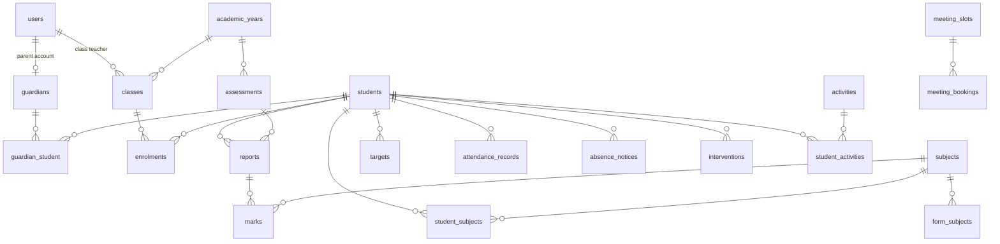

# MySQL schema proposal (for review)

Status: **draft for review, nothing built yet.** Laravel 13, MySQL 8 (utf8mb4), one school.
Sized for the 2026 enrolment: 2,652 students, 60 classes, 124 teachers, about 2,000+ parent accounts.

Questions for you are at the end (Q1–Q7). Answering them may change some tables.

## 1. Main ideas

1. **One login table for everyone** (`users`) with a fixed role: `parent`, `class_teacher`, `admin`, `super_admin`. Login with email, IC number or phone, plus password.
2. **Parents are linked to students through guardians.** A guardian record exists even before the parent has an account, so the school can import guardians first and create accounts later. Siblings are linked by the guardian's IC number.
3. **Everything academic belongs to an academic year.** Classes, enrolments, assessments and reports are per year. Year-end promotion creates next year's enrolments, and past years stay readable.
4. **One report per student per checkpoint.** The report holds the approval status (draft → submitted → approved → published) and the class teacher's comments. Marks belong to the report. This replaces the two separate approval flows in the prototype.
5. **Grades and Gears are calculated from the COEx rules,** not typed in. When a report is **published**, the grade and Gear of each mark are copied onto the mark. Changing the rules later does not rewrite published reports.
6. **Sensitive identity data is protected.** IC numbers are stored encrypted, with a separate one-way hash used for login and matching. Race, religion and citizenship are only sent to admin and super admin (and the class teacher for their own class).
7. **Nothing is hard-deleted** for students, guardians, reports and marks. Records are archived, and every change is in `audit_logs`.

## 2. Diagram

## 3. Tables

Every table also has `id` (bigint) and `created_at` / `updated_at` unless noted. "FK" = foreign key.

### People and access

**users** (all logins)

| Column | Type | Notes |
|---|---|---|
| name | varchar(150) | |
| role | enum | `parent`, `class_teacher`, `admin`, `super_admin` |
| email | varchar(190), nullable, unique | Login option 1 |
| phone | varchar(20), nullable, unique | Login option 2. Stored as digits only, e.g. `60123456789` |
| ic_hash | char(64), nullable, unique | Login option 3. HMAC of the IC digits (keyed with the app key), used to look up a login |
| ic_encrypted | text, nullable | The IC itself, encrypted, for display to admins |
| password | varchar(255) | bcrypt/argon hash |
| must_change_password | boolean | True for one-time passwords from printed slips and staff resets |
| is_active | boolean | Inactive users cannot log in |
| locale | enum `ms`, `en` | Interface language |
| last_login_at | timestamp, nullable | |
| remember_token, deleted_at | | Laravel standard; soft delete |

**guardians** (a parent or guardian, with or without a login)

| Column | Type | Notes |
|---|---|---|
| user_id | FK users, nullable, unique | Set when the guardian gets a login |
| name | varchar(150) | |
| ic_hash / ic_encrypted | as in users | Matching key for siblings and for creating the login |
| phone, email | nullable | |
| address | text, nullable | |
| occupation | varchar(100), nullable | Only if the school's form has it |
| deleted_at | | |

**guardian_student** (who may see which child)

| Column | Type | Notes |
|---|---|---|
| guardian_id, student_id | FK | Unique together |
| relationship | enum | `bapa`, `ibu`, `penjaga` |
| is_primary | boolean | Main contact |
| can_view | boolean | The school can block one guardian (e.g. court orders) without deleting the link |

### School structure

**academic_years**: `year` (smallint, unique, e.g. 2026), `starts_on`, `ends_on`, `is_current` (only one true).

**classes**

| Column | Type | Notes |
|---|---|---|
| academic_year_id | FK | |
| form | tinyint 1–6 | |
| form6_stage | enum `bawah`, `atas`, nullable | Form 6 only |
| name | varchar(60) | e.g. `1 Andromeda`, `PRA U 27 UKM` |
| code | varchar(32) | Short code, unique per year |
| is_dlp | boolean | Dual Language Programme |
| session | enum `pagi`, `petang` | |
| class_teacher_id | FK users, nullable | One class teacher per class per year. Changing it keeps history in `audit_logs` |

**subjects**: `code` (unique), `name_ms`, `name_en`, `is_active`.

**form_subjects**: `subject_id`, `form` (1–6), `is_core` (boolean). The default subject list per form, maintained by admin.

**students**

| Column | Type | Notes |
|---|---|---|
| student_no | varchar(32), unique | The school's own ID (or the generated one) |
| name | varchar(150) | |
| ic_hash / ic_encrypted | nullable | MyKid / IC |
| date_of_birth | date, nullable | |
| gender | enum `L`, `P` | |
| race | enum `melayu`, `cina`, `india`, `lain` | Sensitive: admin roles only |
| religion | enum `islam`, `bukan_islam` (or a fuller list, see Q3) | Sensitive |
| is_citizen | boolean | `false` = MBWN |
| photo_path | varchar, nullable | Private storage, never public_html |
| status | enum | `active`, `transferred_out`, `graduated`, `archived` |
| enrolled_on, left_on | date, nullable | `left_on` starts the retention clock (5 years, then anonymise) |
| deleted_at | | |

**enrolments** (which class a student is in, per year)

| Column | Type | Notes |
|---|---|---|
| student_id, class_id, academic_year_id | FK | |
| starts_on, ends_on | date | A mid-year class move closes one row and opens another |
| is_current | boolean | |

Unique: one current enrolment per student per year.

**student_subjects**: `student_id`, `academic_year_id`, `subject_id`. Filled from `form_subjects` when a student is enrolled. Admin can then add or remove electives for one student (Forms 4–6).

### Assessments, reports and marks

**assessments** (checkpoints, per form per year)

| Column | Type | Notes |
|---|---|---|
| academic_year_id | FK | |
| form | tinyint 1–6 | |
| key | varchar(20) | `tov`, `pat`, `ppt`, `trial`, `final` |
| name_ms, name_en | varchar(100) | e.g. `PAT Tingkatan 4` |
| exam_date | date, nullable | Shown on the timeline |
| sort_order | tinyint | |
| is_current | boolean | The checkpoint teachers are entering now |
| is_open | boolean | Teachers can enter marks only while open |

Unique: (academic_year_id, form, key).

**reports** (one per student per assessment)

| Column | Type | Notes |
|---|---|---|
| student_id, assessment_id | FK, unique together | |
| class_id | FK | The class at the time, so moves don't change old reports |
| status | enum | `draft`, `submitted`, `approved`, `published` |
| teacher_comment, support_note, discipline_note | text, nullable | |
| co_score | tinyint, nullable | Co-curricular score |
| attendance_rate | tinyint, nullable | Copied from attendance when published |
| submitted_by / submitted_at | FK users / timestamp | |
| approved_by / approved_at | | |
| published_by / published_at | | |
| parent_acknowledged_by / _at | FK users / timestamp | "Sahkan telah dibaca" |

**marks**

| Column | Type | Notes |
|---|---|---|
| report_id, subject_id | FK, unique together | |
| mark | tinyint 0–100, nullable | null = not entered yet |
| is_absent | boolean | TH (tidak hadir peperiksaan) |
| grade, gear | varchar(4), tinyint, nullable | Filled only when the report is published |
| entered_by | FK users | |

**targets**: `student_id`, `academic_year_id`, `subject_id`, `target_mark`, `set_by`. Unique per student, year and subject. When there is no target, the app suggests one from the current mark (as now).

**coex_rules**: `gear` (1–11, unique), `min_mark`, `max_mark`, `grade`, `zone`, `level`, `action_ms`, `action_en`, `color`. The app checks that ranges cover 0–100 with no gaps or overlaps before saving.

### Daily records

**attendance_records**

| Column | Type | Notes |
|---|---|---|
| student_id | FK | |
| date | date | Unique with student_id |
| status | enum | `P` hadir, `A` tidak hadir, `L` lewat, `MC` cuti sakit, `U` urusan rasmi |
| note | varchar(255), nullable | |
| recorded_by | FK users | |

About 500,000 rows per year (2,652 students × ~190 school days). Indexed on (date) and (student_id, date).

**absence_notices** (sent by parents): `student_id`, `submitted_by` (FK users), `date_from`, `date_to`, `reason` (enum: `keluarga`, `kesihatan`, `mc`, `lain`), `note`, `document_path` (nullable), `status` (`submitted`, `acknowledged`, `rejected`), `reviewed_by`, `reviewed_at`.

**announcements**: `title_ms`, `title_en`, `body_ms`, `body_en`, `category`, `audience` (`all`, `form`, `class`), `audience_value` (nullable), `published_at`, `created_by`.

**meeting_slots**: `class_id`, `teacher_id`, `date`, `starts_at`, `ends_at`, `capacity`.
**meeting_bookings**: `meeting_slot_id`, `student_id`, `booked_by` (FK users), `topic`, `status` (`booked`, `cancelled`, `done`).

**activities**: `name`, `type` (`kelab`, `sukan`, `badan_beruniform`, `lain`), `is_active`.
**student_activities**: `student_id`, `activity_id`, `academic_year_id`, `role_or_detail`, `score`, `achievement`.

**interventions**: `student_id`, `subject_id` (nullable), `type`, `owner_id` (FK users), `follow_up_on`, `note`, `status` (`active`, `resolved`), `resolved_at`, `created_by`.

### System

**settings**: `key` (unique), `value` (JSON). Holds school name, address, phone, email, office hours, LMS pass mark, credit Gear and Purple Gear.

**audit_logs**: `user_id` (nullable), `action`, `auditable_type`, `auditable_id`, `old_values` (JSON), `new_values` (JSON), `ip_address`, `user_agent`, `created_at`. Kept permanently. Not editable from the app.

**notifications**: Laravel's standard table, used for the in-portal bell (no email at launch).

**privacy_notices**: `version`, `content_ms`, `content_en`, `published_at`.
**consents**: `user_id`, `privacy_notice_id`, `accepted_at`, `ip_address`. A parent must accept the current notice before seeing data.

**import_batches**: `type` (`students`, `guardians`, `marks`), `file_name`, `uploaded_by`, `rows_total`, `rows_imported`, `rows_skipped`, `errors` (JSON: row number and reason), `status`.

Laravel's own tables stay as they are: `sessions`, `cache`, `jobs`, `failed_jobs`, `password_reset_tokens` (unused while there is no email).

## 4. Who can see and change what

| Data | Parent | Class teacher | Admin | Super admin |
|---|---|---|---|---|
| Own children: published reports, marks, attendance | View | | | |
| Own class: students, marks, attendance, comments | | View and edit (until submitted) | View and edit | View and edit |
| All students and classes | | | View and edit | View and edit |
| Race, religion, citizenship, IC | | Own class only, view | View and edit | View and edit |
| Approve and publish reports | | | Yes | Yes |
| Users, roles, password resets | Own password | Own password; reset parents of own class | Reset parents and class teachers | Everything |
| COEx rules, settings, privacy notice | | | | Yes |
| Audit log | | | View | View |

These rules are enforced on the server (Laravel policies). The browser only receives data the user is allowed to see.

## 5. Questions for you

- **Q1. Student ID:** will the school's spreadsheet have a student number, the student's MyKid/IC number, or both? The design accepts both; `student_no` is required, so if the school has none, the portal will generate one.
- **Q2. Approval:** approve report by report (as in the prototype), or let the admin approve a whole class in one click? I suggest both: one-click for a class, with per-student review still possible.
- **Q3. Religion:** is "Islam / Bukan Islam" enough (as in the enrolment sheet), or does the school need the full list (Buddha, Hindu, Kristian, ...)?
- **Q4. Electives:** do Form 4–6 students in the same class take different subjects? If not, `student_subjects` can be dropped and subjects come straight from the class.
- **Q5. Form 6:** confirm the four Form 6 classes are recorded as Form 6 with stage `bawah`/`atas`, using checkpoints Diagnostik, Semester 1, 2, 3.
- **Q6. Report comments:** one class-teacher comment per report (as now), or a comment per subject?
- **Q7. Meetings:** keep teacher meeting bookings at launch, or leave them for a later version to launch sooner?

## 6. Defaults used while you were away

You asked me to continue without waiting, so the build uses these answers. Each is easy to change later.

| Question | Default used |
|---|---|
| Q1 Student ID | Both columns kept. `student_no` comes from the spreadsheet; if empty, the portal generates `BTK` + year + running number. |
| Q2 Approval | Both: approve or publish a whole class in one click, or one report at a time. |
| Q3 Religion | `islam` / `bukan_islam`, as on the enrolment sheet. |
| Q4 Electives | `student_subjects` kept, pre-filled from the form's subjects. |
| Q5 Form 6 | Form 6 with stage `bawah`/`atas`; checkpoints Diagnostik, Semester 1, 2, 3. |
| Q6 Comments | One class-teacher comment per report. |
| Q7 Meetings | Kept, since the prototype already has them. |
